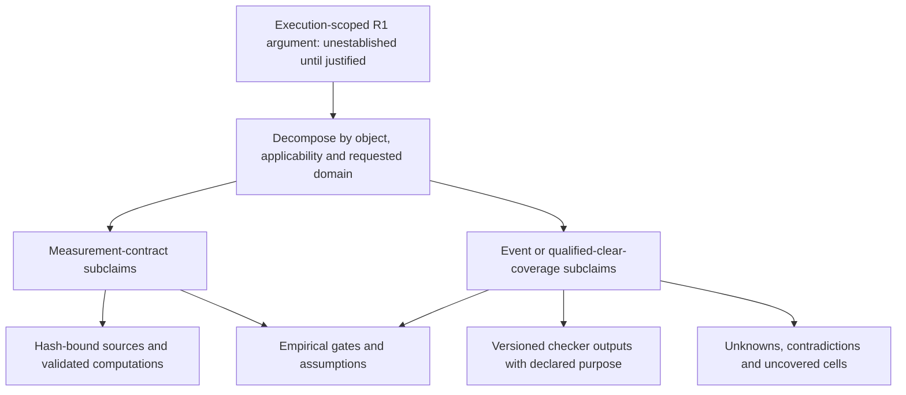

# Next research milestones — plan only

Recommended next implementation milestone: **a versioned evidence registry and typed GSN-style argument scaffold, with empirical admission disabled**. Run the minimal independent-reference/contract study as a separate research track. Useful safety-case infrastructure can progress while physical predicates remain unestablished; it must expose those gaps rather than conceal them. No retrieval system, argument generator or multi-agent workflow is implemented here.

## Sequence and exit artifacts

| Priority | Proposed task | Inputs | Concrete exit artifacts / acceptance |
|---|---|---|---|
| M1 | Deterministic evidence registry and claim-to-evidence binding | Existing manifests, requirements, measurements, derived records, gate reports and frozen checker outputs | Versioned index/bundle schema, content hashes, exact selectors, lineage/conflict fields and tests rejecting version/scope mismatches; no semantic retrieval or empirical activation needed |
| M2 | Typed GSN-style graph and checker-result integration | M1 bundles; V3 compatibility mapping; V4 configuration/assessment schemas | Graph schema/linter and fixture argument graphs preserving unknown/invalid/NA/empty scope, coverage and gate prerequisites; unsupported physical goals stay unestablished |
| M3 | Retrieval-grounded single-drafter baseline | M1/M2 plus a prospectively fixed evidence-relevance/reference set | Reproducible evidence bundles, citation audit, retrieval evaluation and single-agent draft baseline; only then test lexical versus semantic retrieval if justified |
| M4 | Controlled drafting/criticism/revision workflow | Same bundles, model/token budget and graph constraints as M3 | Versioned prompts/roles, structured graph patches, immutable evidence, traceable revisions and compute-matched self-review control; AI agreement never establishes physical truth |
| M5 | Framework evaluation and ablations | Frozen protocol, disjoint evaluation and independent argument/reference review | Citation/claim/graph/uncertainty/revision metrics with explicit denominators, baselines, strata and failure cases; physical-checker accuracy withheld until valid references exist |
| Parallel evidence track | Minimal support/geometry/phase/reference validation | Current candidates and additional evidence plan | Independently justified contracts/reference freeze; a separately reviewed empirical admission proposal only after relevant gates pass |

M1/M2 should be bounded implementation tasks with reviewable fixtures and deterministic outputs. Do not expand physical detection or launch benchmark-wide experiments merely to build the argument framework.

## Versioned claim-to-evidence retrieval

Proposed index fields: evidence ID/kind; exact source hash/path/selector; requirement ID/version/hash; configuration and assessment-manifest hashes; execution/task/model/object/surface identities; observation clock/domain/frame interval; producer/code/adapter/profile versions and hashes; derivation dependencies; calibration/validation status; missing/invalid/conflict scope; human/AI interpretation provenance and exposure; natural/controlled/development/held-out stratum.

Keep raw observations, derived geometry, checker conclusions, provisional AI interpretations and approved references as different kinds. AI reviews in this phase are interpretations, not physical witnesses. A retrieval request supplies explicit requirement/object/surface/domain/version scope from validated configuration; the LLM cannot silently select protected objects or extend a surface mapping.

First use exact metadata/content-addressed lookup and deterministic filtering. Later ranking may optimize relevance but must never override identity/version/clock/capability filters or treat a ranking score as physical confidence. Return supporting facts, counterevidence, missing requirements and shared dependencies together. Two camera views/exports of one source are not independent corroboration.

Use fixed, hash-bound evidence bundles for reproducibility. Retrieval must not bridge temporal gaps, drop contradicted evidence, re-arm applicability, reinterpret source measurement phases, or replace missing fields with generated prose.

## GSN-style graph integration

Proposed node kinds: goal/claim, strategy, context, assumption, measured/derived evidence, checker-result assertion, uncertainty/gate and counterevidence. Each node/edge carries source/version/scope provenance and a validation state. This is a GSN-style engineering plan, not a standards-conformance or certification claim.

Ingest frozen V3 outputs without regenerating predictions or changing seals. Preserve their legacy requirement/checker/observation scope; do not retag them as empirically validated R1 v2.0 conclusions. Ingest V4 analytical outputs as analytical conformance evidence only. Future empirical outputs require an admitted profile/calibration manifest and compatible versions.

Preserve the full per-object vector and deterministic aggregation, not a single unconditional safety Boolean. Input rejection differs from assessed invalidity; NA/empty scope is not a safety pass. Missing support or coverage remains unknown. An admitted positive must survive its own dependencies; unrelated gaps remain visible. A physical top-level goal cannot be established by a synthetic witness, unvalidated legacy label, AI interpretation or disabled empirical profile.

## Multi-agent drafting, criticism and revision

Proposed roles: an evidence curator assembles a versioned bundle; a drafter constructs graph/prose claims; a critic checks citation entailment, scope, contradictions and unsupported certainty; a revision role applies explicit graph patches; a deterministic validator enforces schemas, dependencies and admission constraints. All agents read the same frozen source registry and cannot edit checker outputs, calibrations or references.

Start from the single-drafter baseline before adding roles. Compare multi-agent revision against single-agent self-review using matched model, evidence access and token/tool budget. Preserve model/version/prompt/config hashes, source inspection records and every proposed/rejected patch. A critic vote is an interpretation, not ground truth. A majority cannot resolve contradictory measurements or bypass a physical gate.

Checker feedback is read-only: identify invalid configurations, unsupported measurements, unknown scope and qualified coverage rather than asking an agent to force a pass. Revision must preserve unaffected evidence and explain which claim or assumption changed. Avoid recursive self-labeling: generated arguments and predictions cannot become independent references.

## Evaluation baselines and ablations

Plan these comparisons under a frozen protocol; none is run here:

| Baseline | Purpose |
|---|---|
| Deterministic evidence/graph template without LLM | Measure what structured provenance and rule checks provide alone |
| Single LLM without supplied evidence | Research control for unsupported claims, never an approved safety output |
| Single drafter with fixed curated bundle | Separate grounding from retrieval effects |
| Single drafter with retrieved bundle | Measure retrieval contribution under identical generation constraints |
| Single drafter plus self-review | Compute-matched control for revision versus additional agents |
| Multi-agent draft/critic/revision without checker feedback | Isolate the role of formal/empirical checker information |
| Full pipeline with versioned retrieval and frozen checker feedback | Evaluate the integrated framework while retaining admission restrictions |

Ablate provenance/version filters, lexical versus semantic ranking, measured versus visual modalities, checker feedback, critic/revision roles, explicit uncertainty nodes and source-dependency tracking. Unsafe filter/uncertainty removals are offline diagnostic conditions only. Use identical evidence/model budgets where comparisons require them; record additional computation separately.

Primary framework metrics: exact citation resolution and hash/version correctness; independently reviewed claim-evidence support; unsupported physical assertion rate; contradiction/uncertainty coverage; requirement/object/domain coverage; graph structural validity; correct handling of unknown/invalid/NA; revision correctness and evidence preservation; inspection/token/runtime cost. Evaluate retrieval relevance/coverage against independently reviewed evidence sets. Do not infer safety-predicate accuracy from argument fluency, AI agreement or graph validity.

Keep checker accuracy/localization separate from argument-quality evaluation. Physical metrics require valid independent positives, eligible negatives, NA/U and compatible observation domains, explicit denominators and uncertainty. Do not count missing/NA as TN or synthetic success as empirical effectiveness. Provisional AI proposals may guide development but cannot be evaluation truth.

Split by execution/source lineage, not by overlapping candidate category, camera or frame. Keep natural and controlled strata separate and preserve prior exposure disclosures. Existing NV01–NV20, references and seals stay frozen; any later evaluation use requires its original protocol approvals and compatible scope. Establish a prospective independent validation cohort before making new generalization claims.

## Immediate proposed acceptance checklist

For the next separately authorized implementation task: a closed evidence schema; exact-ID/hash retrieval with version/scope rejection tests; a typed GSN-style fixture graph with unestablished physical goals; immutable V3/V4 output ingestion; explicit AI/reference kinds; counterevidence/uncertainty edges; and an audit report showing empirical admission remains disabled. This advances the complete safety-case framework without making unsupported physical conclusions.
