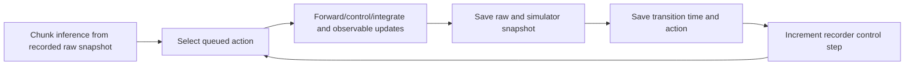

# Temporal reconstruction

All 432 executions/104 variants use a 0.002s compiled Euler timestep and recorded 20Hz control frequency. Saved simulator intervals are 0.05s (25 substeps); floating accumulation errors are separate from alignment. Snapshot wall/monotonic clocks are not camera exposure times.

Frame zero follows benchmark restoration. Frames 1..10 follow settling. Action k precedes saved frame k+11. Latest available snapshot before action k is k+10. Actual inference input is frame 10+inference_calls[chunk_id].step; queued actions reuse that earlier input. All 53,323 action/chunk associations and simulator transition times were checked. Settling control_step zero is not a unique time index.

Same-index association is VERIFIED. A common physical instant across endpoint state, native caches and raw observations is not established. For the nine scalar arm/finger joints, initial configurations equal endpoint state; subsequent values satisfy q_raw=q_endpoint-h*v_endpoint. This equation is not applied componentwise to generic quaternion-containing qpos arrays. Inverse Euler consistency reconstructs raw velocities within predefined roundoff bounds. No offset is fitted to maximize agreement; no data is shifted or interpolated.

The -0.002s cache-time interpretation is CONDITIONAL on the Euler model and production interpretation. Individual sensor timestamps and historical binary attestation are absent. Algebraic reconstructions are validation-only, never raw indexed samples. Synchronized, endpoint-shifted, exposure-clock and world-transform retrieval remain UNSUPPORTED. Model consistency does not establish a calibrated physical instant.

Sparse-window fixtures preserve exact keys; selected actual recordings are complete. The initial provisional policy_input_frame label is superseded in AUDIT_FINAL.json by latest_available_observation_frame and actual policy_inference_input_frame, validated from chunk metadata. The diagnostic is retained.
